# Prox4u — Monitoring dashboard

Web monitoring dashboard for a **Proxmox VE 9** cluster: management view (KPIs, Health Score, multi-site PRA, capacity planning) and operations view (historical metrics, network topology, storage, alarms).

A **CIETED EURL** project — [www.cieted.fr](https://www.cieted.fr) · [Prox4u](http://www.prox4u.fr/) product

> French version: [README.md](./README.md)

---

## Documentation

| Document | Purpose |
|---|---|
| [`skills/`](./skills/) | **Knowledge base** for handover (human or AI): 13 per-module skills (architecture, plugins, API, shared, operations…) + [inventory and maintenance rules](./skills/README.md) |
| [`STATUS.md`](./STATUS.md) | Progress status: delivered milestones, fixed pitfalls, pending items |
| [`deploiement/DEPLOY.md`](./deploiement/DEPLOY.md) | Deployment procedure on a new server ([FR version](./deploiement/DEPLOY.md)) |

## Features

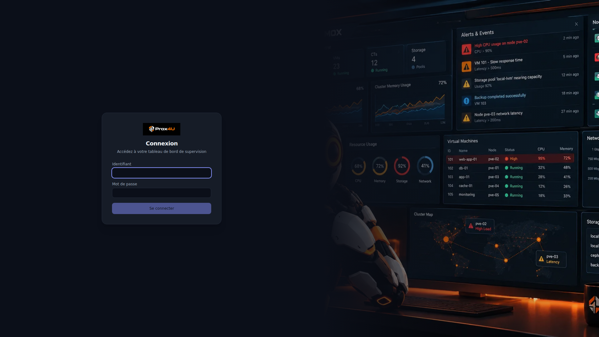

*Secure login — per-user accounts with roles (admin / user).*

- **Multi-cluster / standalone nodes**: multiple Proxmox endpoints declared in `clusters.json` (one per cluster or standalone node); aggregated overview + a full dashboard per endpoint, navigable from the sidebar. One failing endpoint does not affect the others.
- **Real-time snapshot** (WebSocket, 5 s tick): cluster KPIs, Health Score, per-site PRA + **global cross-endpoint PRA**, top VM/pool consumers, alarms.
- **Historical metrics** with dual source: **InfluxDB 3 Core** (native) with automatic fallback to **Proxmox RRD**. A badge in the Metrics panel shows the active source.
- **Capacity planning**: CPU/RAM/disk saturation forecasts (30 d) + 7-day trend.
- **Demo mode** (`MOCK=1`): simulated multi-site cluster, no Proxmox required.
- **Alarms & Centreon**: monitoring rules on VMs/nodes (CPU, RAM, disk, status, IP, uptime, network) → alarms forwarded to **Centreon** as passive checks via `send_nsca`. Automatic provisioning of the passive service (CLAPI SSH/local or REST v1 API) + VM→Centreon-host mapping (manual add) + pollers with IP (NSCA destination) + admin config page.

### Overview

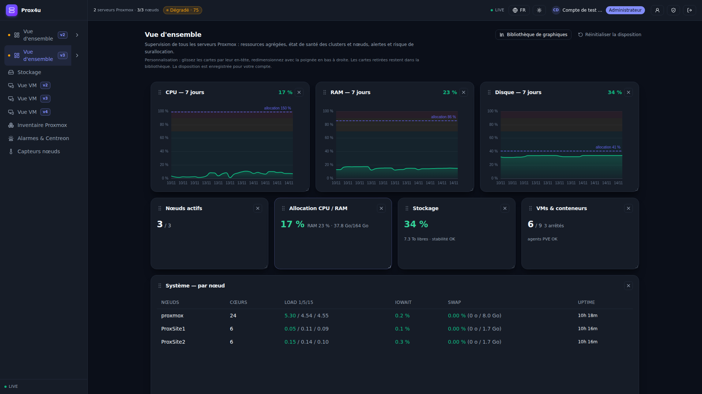

Aggregated supervision of all Proxmox servers: 7-day CPU/RAM/disk, allocation, storage and per-node system, real-time.

### Endpoint detail

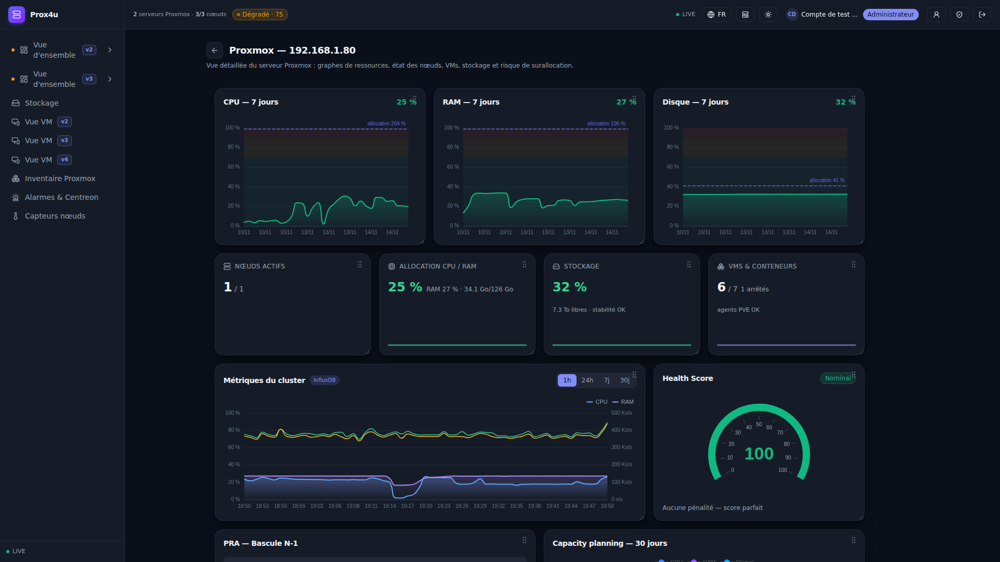

Full per-endpoint dashboard: 7-day charts, cluster metrics (InfluxDB/RRD), Health Score, N-1 PRA failover and 30-day capacity planning.

### Node detail

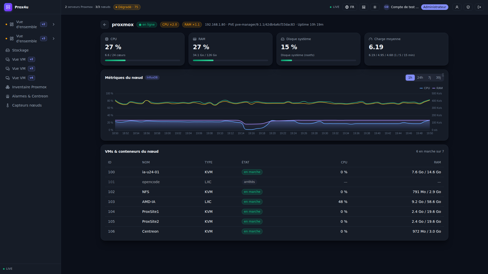

Proxmox node detail: system CPU/RAM/disk, average load, historical node metrics and hosted VMs list.

### VM view

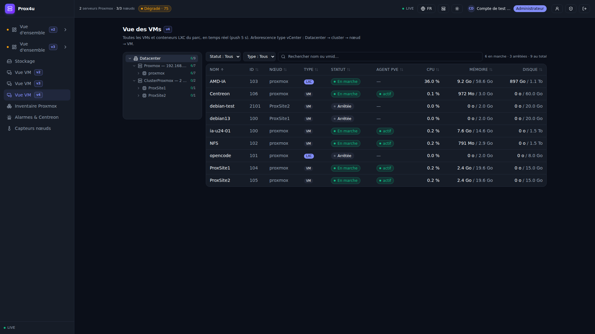

Real-time inventory (5 s push) of all VMs and LXC containers in the fleet, multi-endpoint, vCenter-style tree.

### VM detail

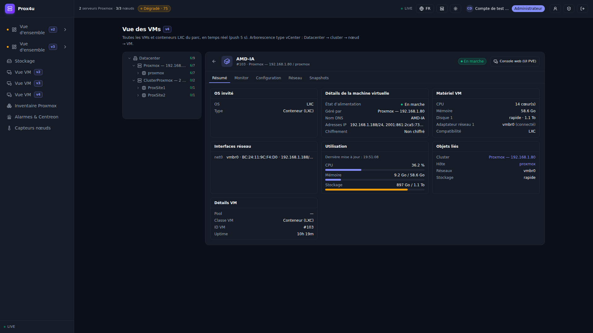

VM/LXC detail panel: summary (guest OS, hardware, network, usage), monitor, configuration, snapshots and PVE web console.

### Proxmox inventory

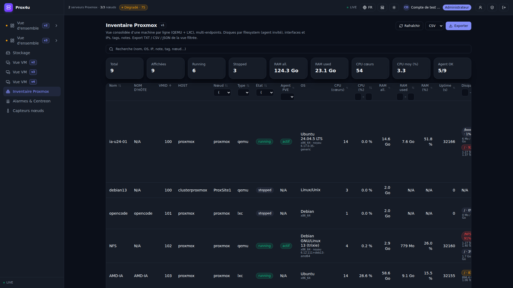

Consolidated view, one machine per line (QEMU + LXC): real OS (guest agent), per-filesystem disks, interfaces and IPs, TXT/CSV/JSON export.

### Network topology

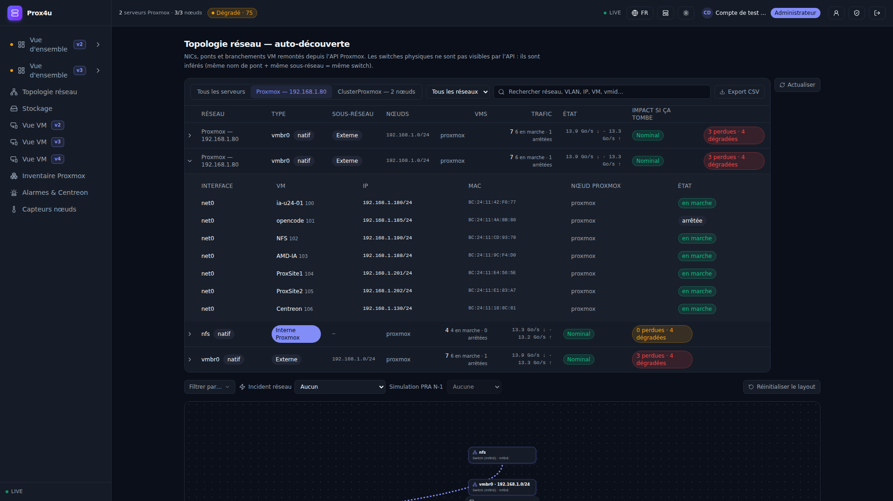

Auto-discovered network topology (switches → nodes → bridges → segments → VMs) with inventory, unified search and incident impact analysis.

### Storage

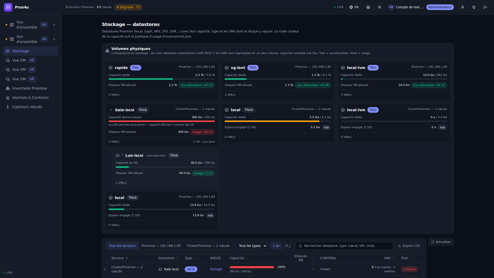

Datastore inventory (local, Ceph, NFS, iSCSI, ZFS): real capacity, type, overallocation and hosted VMs, multi-endpoint.

### Alarms & Centreon

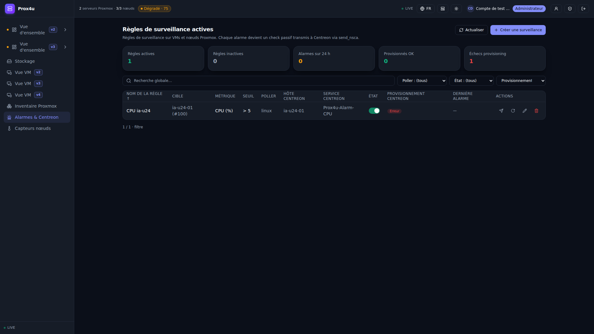

VM/node monitoring rules (CPU, RAM, disk, status, IP, uptime) → alarms forwarded to Centreon as `send_nsca` passive checks, automatic provisioning.

### Node sensors

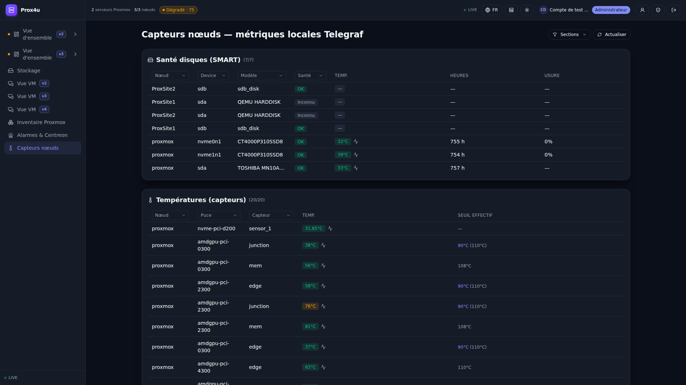

Per-node local Telegraf metrics: SMART disk health, sensor temperatures, ZFS ARC and systemd units, with customizable thresholds.

### Administration

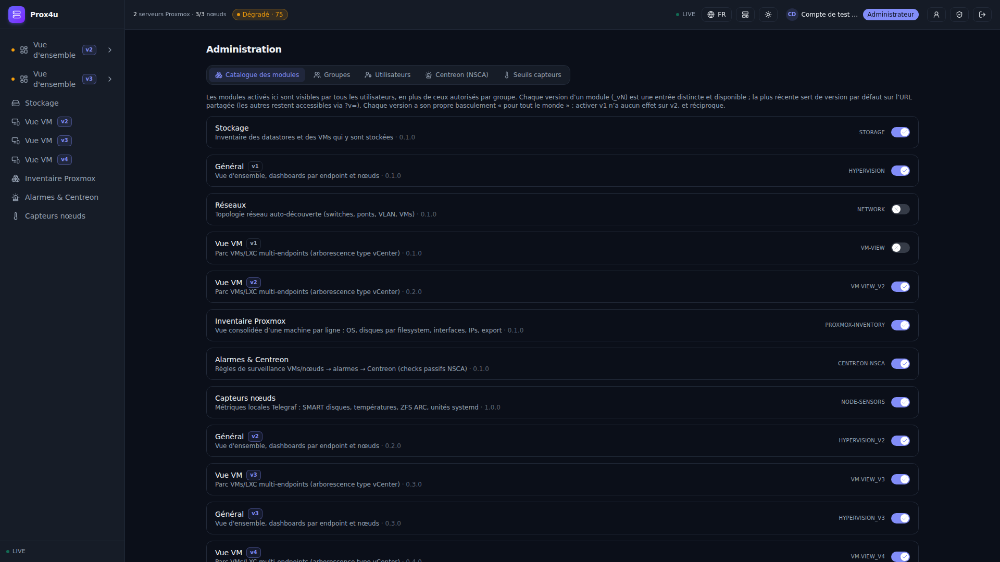

Administration: module catalog (per-version activation), groups, users, Centreon (NSCA) and sensor thresholds.

## Architecture

```
Proxmox VE 9 (API) × N endpoints ──► Poller (5 s, parallel per endpoint) ──► Multi snapshot ──► WebSocket ──► UI
                                                         │
                                                         ├─► InfluxDB 3 Core: raw database (31-day retention, 5 s samples, cluster tag)
                                                         │        │
                                                         │        └─► Consolidator (5 min, per cluster) ─► consolidated database (∞, 5-min buckets)
                                                         │
                                                         └─► History fallback: Proxmox RRD (if InfluxDB absent/unavailable)

HTTP API: /api/dashboard · /api/endpoints · /api/metrics?timeframe=hour|day|week|month&endpoint=<id> · /api/capacity · /api/trends · /api/health · /api/node-sensors
```

pnpm monorepo: `packages/shared` (types + computations + i18n), `packages/server` (Fastify, poller, PVE client, InfluxDB), `packages/web` (React + ECharts).

## "Alarms & Centreon" module

The module defines **monitoring rules** on Proxmox VMs and nodes. When a condition (threshold + confirmation duration) is met, the alarm is sent to **Centreon** as a **passive check** via `send_nsca`. The matching passive service is **created and deployed automatically** before the first send.

```
Prox4u (backend)
   │  1. Passive service provisioning → CLAPI (SSH) or REST v1 API
   │     centreon -u <u> -p "$(cat)" -o SERVICE -a add -v "<host>;<service>"
   │     centreon -o SERVICE -a setparam -v "<host>;<service>;passive_checks_enabled;1"
   │     centreon -o SERVICE -a setparam -v "<host>;<service>;active_checks_enabled;0"
   │     (+ is_volatile=1, max_check_attempts=1, check_command=check_dummy!0)
   │     centreon -o POLLERGENERATE -v "<poller>"   then   centreon -o CFGMOVE -v "<poller>"
   │  2. Engine (15 s tick): evaluates the rules → ok⇄firing state machine
   ▼
send_nsca (runtime)
   │  printf '<host>\t<service>\t<code>\t<output>\n' | send_nsca -H <nsca_host> -c <send_nsca.cfg>
   ▼
Centreon Engine (NSCA reception → passive service status)
```

- **Mandatory runtime transport**: `send_nsca` (the `send_nsca.cfg` file is **generated automatically** by the app from its config, chmod 600).
- **Return codes**: 0=OK (recovery), 1=WARNING, 2=CRITICAL, 3=UNKNOWN.
- **Provisioning**: CLAPI (**SSH** mode — Prox4u is not on the central server — or local) **or** REST v1 API. The choice is made in the admin UI ("Centreon (NSCA)" tab). Passwords/tokens are never logged nor returned in clear text by the API.

### Centreon / NSCA prerequisites (step by step)

1. **NSCA daemon on the Centreon central server**: `nsca.cfg` with `server_address` (0.0.0.0), `server_port` (5668), `allow_2des = true`, and a `password` (same password as in Prox4u). Restart the `centengine`/`nsca` service.
2. **`send_nsca` client on the Prox4u server**: `apt-get install nsca-client` (or equivalent) — the `send_nsca` binary must be in the `PATH`.
3. **CLAPI user** (if using the CLAPI transport): a Centreon account with configuration rights (`SERVICE`, `POLLERGENERATE`, `CFGMOVE`) + an **SSH key** from Prox4u to the central server (`ssh` mode).
4. **API token** (if using the REST v1 transport): a Centreon API user + its token (Basic auth on `/api/restapi`).
5. **Poller**: the target poller must already exist in Centreon (Linux, Windows, Infra…). The passive service is attached to the host already present in Centreon.

### Procedure in Prox4u

1. **Administration → Centreon (NSCA)**: enable the module, choose the transport (CLAPI/REST), fill in the central server + credentials, the pollers (**name + IP** — the IP is the NSCA destination for this poller's frames, falling back to the central's NSCA server if empty), the NSCA server (host/port/password), and the VM→Centreon-host mapping (**Add** button for other mappings).
2. **Alarms & NSCA checks → Create a monitoring rule**: define the rule (VM/node target, metric, operator, threshold, confirmation duration, severity, poller, Centreon host+service, message). On submit, the service is provisioned + the config deployed, then the rule is saved (provisioning status displayed).
3. **Rules table**: enable/disable, **Test** (immediate NSCA frame), **Re-provision** (retries creation on failure), delete.

### Delivered examples

- **Generated frame**: `vm-web-01\tProx4u-Alarm-CPU\t2\tvm-web-01 CPU 94% (threshold 90%)\n`
- **CLAPI creation command**: `centreon -u clapi -p "$(cat)" -o SERVICE -a add -v "vm-web-01;Prox4u-Alarm-CPU"` (followed by the `setparam` + `POLLERGENERATE`/`CFGMOVE` calls).
- **Manual test script**: [`scripts/nsca-test.sh`](./scripts/nsca-test.sh) — sends a frame to a test NSCA and checks the status in Centreon.

> **Zabbix later**: the `centreon-nsca` family and the `/api/alarms/*` namespace are designed to host a 2nd backend (Zabbix) without touching the core — the runtime transport and provisioning would be specialized per backend.

## Prerequisites

- Node.js ≥ 20, pnpm ≥ 9
- Proxmox VE 9 with a **read-only API token** — to be created **by commands, no GUI**: `deploiement/10-proxmox-token.sh` on each Proxmox server (`ManagerReader` role + dedicated user + token + self-test)
- Docker (optional) for InfluxDB 3 Core

> **Deployment on another server**: full procedure in [deploiement/DEPLOY.md](./deploiement/DEPLOY.md) — tarball via `deploiement/20-package-release.sh` (no git), tokens by commands, systemd at boot.

## Quickstart

```bash
git clone <repo> && cd Prox4u
cp .env.example .env          # then edit INFLUX_URL / tokens (or clusters.json for multi-endpoint)
pnpm install
pnpm build

# InfluxDB (optional but recommended) — scripts numbered in execution order
./deploiement/40-tls-init.sh      # generates the self-signed certificates (data/tls/)
./deploiement/50-influxdb-init.sh # generates the admin token + updates .env
sudo chown -R 1500:1500 data/influxdb   # non-root container user (see note below)

./up.sh                       # full startup: InfluxDB (Docker) + application
# or separately:
# docker compose up -d influxdb
# ./server.sh start           # or: pnpm dev (development mode)
```

The application is on <https://localhost:8080> (self-signed certificate: the browser will ask for confirmation). Without `INFLUX_TOKEN` (or without Docker), everything runs on the Proxmox RRD fallback.

**Explorer** (official InfluxDB 3 UI: SQL queries + visualizations) is on <https://localhost:8888> — preconfigured connection to InfluxDB (`data/explorer/config/config.json`). Optional: `docker compose up -d explorer` / `docker compose stop explorer`.

> **Permissions note (Docker)** — the container runs as a non-root user (`user: 1500:1500`, configurable via `INFLUX_UID`/`INFLUX_GID` in `.env`): the `data/influxdb/` directory must be owned by it (`chown -R`). Official InfluxDB docs don't cover this. TLS keys are 644 so that user can read them (self-signed certs, local deployment).

## Configuration

Variables in `.env` (see `.env.example`):

| Variable | Default | Description |
|---|---|---|
| `PVE_URL` | `https://127.0.0.1:8006` | Proxmox API URL |
| `PVE_USER` / `PVE_TOKEN_ID` / `PVE_TOKEN_VALUE` | — | API token credentials (`user@realm!tokenid=value`) |
| `TLS_REJECT_UNAUTHORIZED` | `false` | `true` = reject self-signed certificates |
| `MOCK` | `0` | `1` = simulated data (demo) |
| `MOCK_SCENARIO` | `nominal` | `nominal` \| `degraded` \| `critical` |
| `PORT` | `8080` | Server port (HTTP or HTTPS depending on TLS) |
| `TLS_KEY` / `TLS_CERT` | *(empty)* | Application certificate pair — **empty = plain HTTP** |
| `INFLUX_URL` | `http://localhost:8181` | InfluxDB 3 Core URL (`https://…` for TLS) |
| `INFLUX_TOKEN` | *(empty)* | Admin token (`apiv3_…`) — **empty = InfluxDB disabled** |
| `INFLUX_RAW_DB` | `raw` | Raw database (31-day retention) |
| `INFLUX_AGG_DB` | `consolidated` | Consolidated database (infinite retention) |
| `INFLUX_CA_CERT` | *(empty)* | Self-signed InfluxDB certificate to trust (app → InfluxDB fetch) |
| `INFLUX_LAN_BIND` | `127.0.0.1` | Internal IP exposing the InfluxDB API (8181) for the nodes' Telegraf agents — *empty = localhost-only* |

## Multi-cluster

A `clusters.json` file at the root declares the Proxmox endpoints (one per cluster, or one per standalone node). Copy `clusters.example.json`, fill it in, then `chmod 600 clusters.json`:

```json
{
  "endpoints": [
    { "id": "proxmox", "name": "Main cluster", "url": "https://192.168.1.80:8006",
      "token": "user@pve!tokenid=xxxxxxxx" }
  ]
}
```

- **`clusters.json` is gitignored** (contains tokens); the `clusters.example.json` template is committed.
- Without this file, the app falls back to a single `default` endpoint built from the `.env` `PVE_*` variables.
- Each site in `sites.json` is bound to an endpoint via its `"endpoint"` field (id).
- InfluxDB history is tagged by `cluster`; rows written before multi-cluster support (untagged) are attributed to the default endpoint — no backfill needed.

## InfluxDB 3 Core

- **Two databases**: `raw` (native **31-day** retention, 5 s samples) and `consolidated` (**infinite** retention, 5-minute aggregates). Retentions are set at creation (immutable in Core) and re-created automatically at boot.
- **Consolidator**: internal 5-minute job (complete windows only), with resume-after-restart via `data/influxdb/consolidation-state.json`.
- **Fallback**: any InfluxDB error or empty response automatically switches to Proxmox RRD; the `source` field (`influx` | `rrd`) is returned by the API and shown in the UI.

### Measurement schema

| Database | Measurement | Tags | Fields |
|---|---|---|---|
| `raw` + `consolidated` | `storage_metrics` | `cluster` | `used_bytes`, `total_bytes` — VM storage at endpoint level, reference series of the "Disk" charts (weighted Σused/Σtotal on read) |
| `raw` + `consolidated` | `node_metrics` | `cluster`, `node` | `cpu_pct`, `ram_pct`, `disk_pct` (rootfs), `net_in_bps`, `net_out_bps` |
| `raw` + `consolidated` | `vm_metrics` | `cluster`, `node`, `vmid`, `name` | `cpu_pct`, `mem_bytes` (running VMs only) |

Reads: `hour`/`day`/`week` from `raw` (1 min / 5 min / 1 h buckets), `month` + capacity + trends from `consolidated`.

## TLS

HTTPS for the application **and** InfluxDB, with locally generated self-signed certificates (no external CA).

```bash
./deploiement/40-tls-init.sh   # generates data/tls/{app,influxdb}-{key,cert}.pem (10 years)
```

- **Application**: set `TLS_KEY` + `TLS_CERT` in `.env` → the server listens on HTTPS on `PORT`, WebSocket over `wss`. Without them, plain HTTP.
- **InfluxDB**: the container starts with `--tls-cert/--tls-key` (read-only mounted from `data/tls/`); `INFLUX_URL=https://…` and `INFLUX_CA_CERT` let the app trust the self-signed certificate.

Script options: `TLS_DAYS` (validity, default 3650) and `TLS_SAN_EXTRA` (extra SANs, e.g. `DNS:proxmox.local,IP:192.168.1.50`) to reach the app by a hostname/IP other than `localhost`.

## API

| Endpoint | Description |
|---|---|
| `GET /api/health` | Server status |
| `GET /api/dashboard` | Multi-endpoint snapshot (aggregated KPIs, health + PRA per endpoint + global cross-endpoint PRA + alarms) |
| `GET /api/endpoints` | Compact endpoint list (id, name, state, score) — feeds the sidebar |
| `GET /api/metrics?timeframe=hour\|day\|week\|month&endpoint=<id>` | Metric points of an endpoint + `source` |
| `GET /api/capacity?endpoint=<id>` | 30-day saturation forecasts + `source` |
| `GET /api/trends?endpoint=<id>` | 7-day trend + OS distribution + `source` |
| `GET /api/overcommit-risk?endpoint=<id>` | Dynamic overcommit risk (worst case 7-day p95 per VM) |
| `GET /api/network-topology` | Auto-discovered network topology per endpoint (switches → nodes → bridges → segments → VMs) |
| `GET /api/storage-inventory` | Storage inventory → VMs per endpoint (datastores + VMs with their datastore) |
| `GET /api/node-sensors` | Per-node local Telegraf metrics (SMART, temperatures, ZFS ARC, systemd units) — `raw` database, 1-min cache |
| `WS /ws` | Multi-endpoint snapshot push (5 s) |

## Running & development

### Standard mode — API + frontend on a single port (recommended)

```bash
pnpm build                 # frontend build → packages/web/dist
./server.sh start          # or: stop | restart | status — logs in logs/
```

The server serves the **API and the pre-built frontend** on `https://localhost:8080` (HTTPS when `TLS_KEY`/`TLS_CERT` are set in `.env`, plain HTTP otherwise). After any web code change, re-run `pnpm build` so port 8080 reflects it.

### Development mode — Vite + HMR on port 5173

```bash
./server.sh start          # backend only (or `pnpm dev`: tsx watch server + vite in parallel)
cd packages/web
VITE_API_PROXY=https://localhost:8080 VITE_WS_PROXY=wss://localhost:8080 pnpm dev --host 0.0.0.0
```

The Vite proxy targets `https://localhost:8080` by default; `VITE_API_PROXY`/`VITE_WS_PROXY` point it elsewhere (e.g. a mock).

### Auto-start

| Context | Mechanism |
|---|---|
| **Production** | systemd service `deploiement/prox4u.service` (`Restart=always`, boot + crash) — procedure: [deploiement/DEPLOY.md](./deploiement/DEPLOY.md) §8 |
| **Dev machine** | cron watchdog, `start` being idempotent ("already running" → exit 0): `@reboot …/server.sh start` + `* * * * * …/server.sh start` |

### Utility commands

```bash
pnpm test         # vitest (shared + server)
pnpm typecheck    # tsc --noEmit on the 3 packages
pnpm build        # production build (shared → server → web)
./up.sh           # full startup: InfluxDB (Docker) + application
```

## Layout

```
├── deploiement/              # DEPLOYMENT DELIVERABLE — self-contained: move the whole folder to the target and deploy from it; entry point: DEPLOY.md
│   ├── DEPLOY.en.md          # deployment procedure on a new server (EN) + DEPLOY.md (FR)
│   ├── 10-proxmox-token.sh   # ON EACH PVE: account + read-only Proxmox API token (idempotent, --dry-run)
│   ├── 20-package-release.sh # DEV MACHINE: build + application tarball → releases/ (no secrets)
│   ├── releases/             # application tarball (produced by 20, gitignored) — the kit contains the app
│   ├── 30-env-setup.sh       # APP SERVER: auto-filled .env (INFLUX_UID/GID, EXPLORER_SESSION_KEY) — arg: [install-dir]
│   ├── 40-tls-init.sh        # APP SERVER: self-signed app + InfluxDB certificates (SAN) — arg: [install-dir]
│   ├── 50-influxdb-init.sh   # APP SERVER: InfluxDB admin token + .env sync (idempotent) — arg: [install-dir]
│   └── prox4u.service  # systemd unit of the application server (boot + auto restart)
├── docker-compose.yml        # InfluxDB 3 Core (8181) + Explorer UI (8888), secret token
├── clusters.json             # multi-cluster Proxmox endpoints (600, gitignored) — template: clusters.example.json
├── sites.json                # sites/buildings topology (PRA), binding per endpoint
├── overcommit.json           # overcommit policy + usage thresholds (hot-reload, single source of the color code)
├── skills/                   # knowledge base (13 SKILL.md + README.md) — human or AI handover
├── STATUS.md                 # progress status: delivered milestones, fixed pitfalls, pending items
├── up.sh                     # full startup: InfluxDB (Docker) + application
├── server.sh                 # start/stop/restart/status of the app only
└── packages/
    ├── shared/               # types, computations (PRA, health, forecasts), FR/EN i18n
    ├── server/               # Fastify: multi-endpoint poller, PVE client, InfluxDB, API routes
    └── web/                  # React + ECharts: application host + business plugins (see "Plugin architecture")
```

## Plugin architecture

The frontend (`packages/web`) is a **host** that loads business **plugins**. The three original modules (hypervision, network, storage) are plugins; the host provides the layout, the router, the real-time store and the shared services.

```
packages/web/src/
├── core/                     # HOST — contains no module business code
│   ├── plugin/               # contract + runtime: types (zod), registry, loader, eventBus, logger
│   ├── config/features.ts    # VITE_USE_PLUGIN_* feature flags
│   ├── api/                  # shared REST client (/api/*)
│   ├── data/                 # WS store (zustand) + hooks
│   └── ui/                   # PluginSlot, PluginMenu, ModuleDisabled
├── plugins/                  # PLUGINS — one folder per business module
│   ├── hypervision/          # routes /, /e/:endpointId, /e/:endpointId/n/:nodeId (menu order 10)
│   ├── network/              # route /topology (menu order 20)
│   ├── storage/              # route /storage (menu order 30)
│   ├── vm-view/              # route /vms (menu order 40)
│   ├── proxmox-inventory/    # route /proxmox-inventory (menu order 50)
│   ├── centreon-nsca/        # routes /alarms, /alarms/new, /alarms/edit/:id (menu order 60)
│   └── node-sensors/         # route /node-sensors (menu order 70) — local Telegraf metrics
├── components/               # layout (sidebar, topbar) + shared UI primitives
├── store/ · hooks/ · lib/    # host state (layout, theme), ECharts hook, utilities
└── app.tsx · main.tsx        # bootstrap: loadPlugins() before the first render
```

### Contract

A plugin is a `Plugin` object exported by `plugins/<id>/index.ts`:

```ts
export const storagePlugin: Plugin = {
  manifest: {
    id: 'storage',            // stable, /^[a-z][a-z0-9-]*$/
    name: 'Storage',
    version: '0.1.0',         // semver
    routes: [{ path: '/storage', element: StoragePage }],
    menu: [{ id: 'storage-inventory', to: '/storage', labelKey: 'nav.storage', icon: HardDrive, order: 30 }],
    dependencies: [],         // required plugin ids (optional)
  },
  init(ctx) { /* ctx.api, ctx.eventBus, ctx.logger */ },
  dispose() { /* optional cleanup */ },
};
```

- **Manifest**: validated at load time by a **zod** schema (`pluginManifestSchema`) — an invalid manifest fails the plugin cleanly (per-plugin try/catch in the loader), never the app.
- **Routes**: injected into the host's `<Routes>`; **menu**: rendered by `PluginMenu` (sorted by `order`).
- **Context** (`init(ctx)`): `api` (shared REST client — the frontend never talks to Proxmox/InfluxDB directly), `eventBus`, `logger`. Real-time data flows through the host's WS store (`core/data`).
- **Loader**: static array of explicit imports (`core/plugin/plugins.ts`) — no dynamic async loading, each plugin is isolated by try/catch.

### Feature flags

Each plugin has a `VITE_USE_PLUGIN_<ID>` flag (default **ON**). The flags are circuit breakers: `=false` gracefully disables the module (fallback screen, no dead routes) — useful in production if a plugin misbehaves.

```bash
VITE_USE_PLUGIN_STORAGE=false pnpm dev   # disables the storage module
```

### Adding a plugin

1. Create `plugins/<id>/` with `index.ts` (manifest + `init`) and the module's pages/components.
2. Add it to the `core/plugin/plugins.ts` array (explicit import + flag gating).
3. Declare the flag in `core/config/features.ts`.
4. Routes and the menu entry are automatic (manifest).

## License

A **CIETED EURL** project ([www.cieted.fr](https://www.cieted.fr) · [www.prox4u.fr](http://www.prox4u.fr/)) released under the **Apache License 2.0** — see [`LICENSE`](./LICENSE).
