# Prox4u — Dashboard de supervision

Dashboard web de supervision pour cluster **Proxmox VE 9** : vue DSI/manager (KPIs, Health Score, PRA multi-bâtiments, capacity planning) et vue exploitation (métriques historiques, topologie réseau, stockage, alarmes).

Projet de **CIETED EURL** — [www.cieted.fr](https://www.cieted.fr) · Produit [Prox4u](http://www.prox4u.fr/)

> English version: [README.en.md](./README.en.md)

---

## Documentation

| Document | Rôle |
|---|---|
| [`skills/`](./skills/) | **Base de connaissance** pour la reprise (humain ou IA) : 13 skills par module (architecture, plugins, API, shared, opérations…) + [inventaire et règles de maintenance](./skills/README.md) |
| [`STATUS.md`](./STATUS.md) | État d'avancement : jalons livrés, pièges corrigés, points en attente |
| [`deploiement/DEPLOY.md`](./deploiement/DEPLOY.md) | Procédure de déploiement sur un nouveau serveur ([version EN](./deploiement/DEPLOY.en.md)) |

## Fonctionnalités


*Connexion sécurisée — comptes par utilisateur avec rôles (admin / user).*

- **Multi-cluster / nœuds autonomes** : plusieurs endpoints Proxmox déclarés dans `clusters.json` (un par cluster ou nœud autonome) ; vue d'ensemble agrégée + un dashboard complet par endpoint, navigation dans la barre latérale. Un endpoint en panne n'impacte pas les autres.
- **Snapshot temps réel** (WebSocket, tick 5 s) : KPIs cluster, Health Score, PRA par site/bâtiment + **PRA global cross-endpoints**, top consommateurs VM/pools, alarmes.
- **Métriques historiques** avec double source : **InfluxDB 3 Core** (natif) et repli automatique sur les **RRD Proxmox**. Un badge dans le panneau « Métriques » indique la source active.
- **Capacity planning** : prévisions de saturation CPU/RAM/disque (30 j) + tendance 7 j.
- **Mode démo** (`MOCK=1`) : cluster simulé multi-bâtiments, sans Proxmox.
- **Alarmes & Centreon** : règles de surveillance sur VMs/nœuds (CPU, RAM, disque, statut, IP, uptime, réseau) → alarmes transmises à **Centreon** en checks passifs via `send_nsca`. Provisionnement automatique du service passif (CLAPI SSH/local ou API REST v1) + mapping VM→hôte Centreon (ajout manuel) + pollers avec IP (destination NSCA) + page de config admin.

### Vue d'ensemble

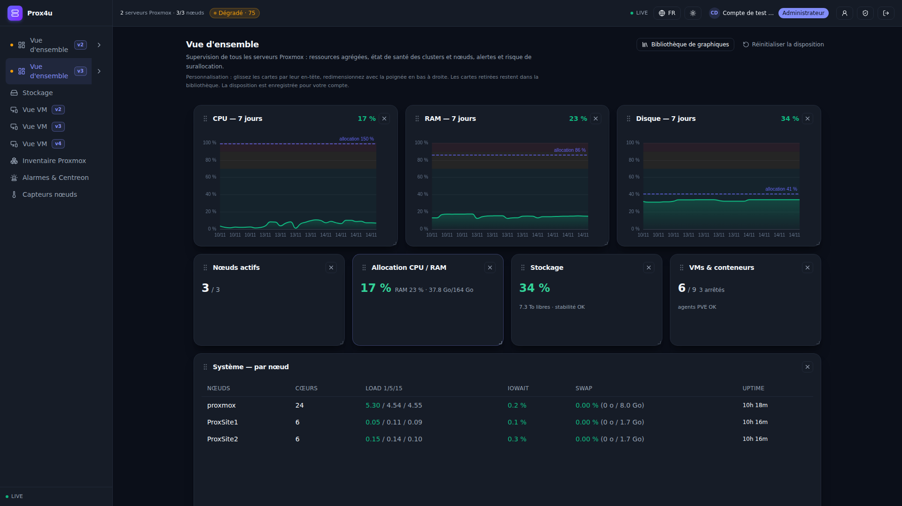

Supervision agrégée de tous les serveurs Proxmox : CPU/RAM/disque sur 7 jours, allocation, stockage et système par nœud, en temps réel.

### Détail endpoint

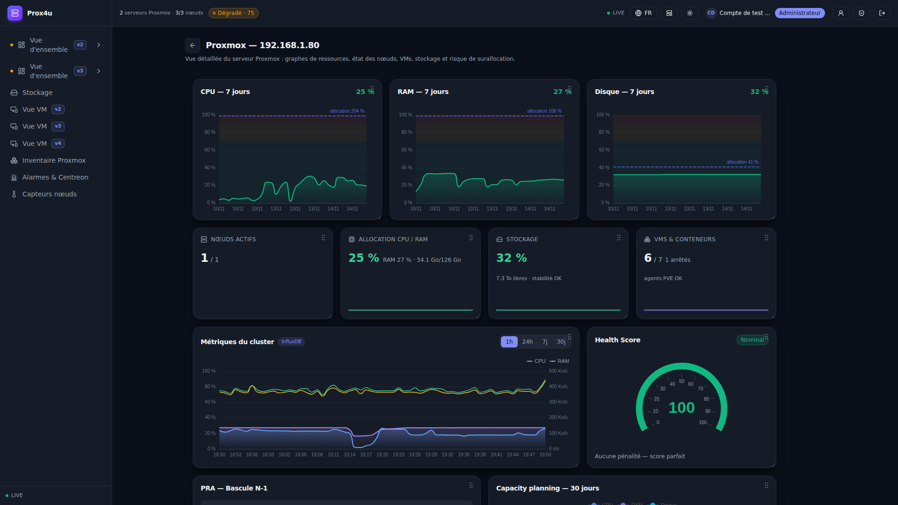

Dashboard complet par endpoint : graphiques 7 jours, métriques du cluster (InfluxDB/RRD), Health Score, PRA bascule N-1 et capacity planning 30 jours.

### Détail nœud

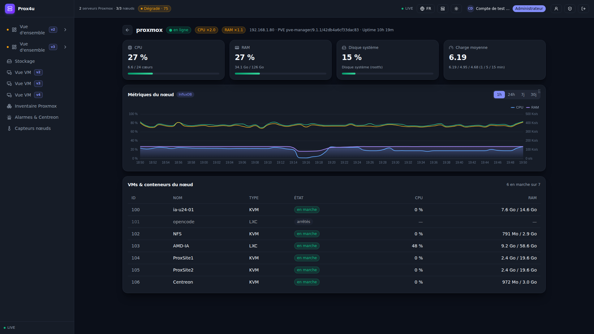

Détail d'un nœud Proxmox : CPU/RAM/disk système, charge moyenne, métriques historiques du nœud et liste des VMs hébergées.

### Vue des VMs

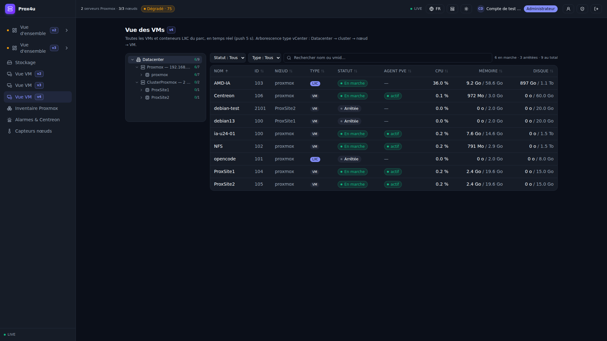

Inventaire temps réel (push 5 s) de toutes les VMs et conteneurs LXC du parc, multi-endpoints, arborescence type vCenter.

### Détail VM

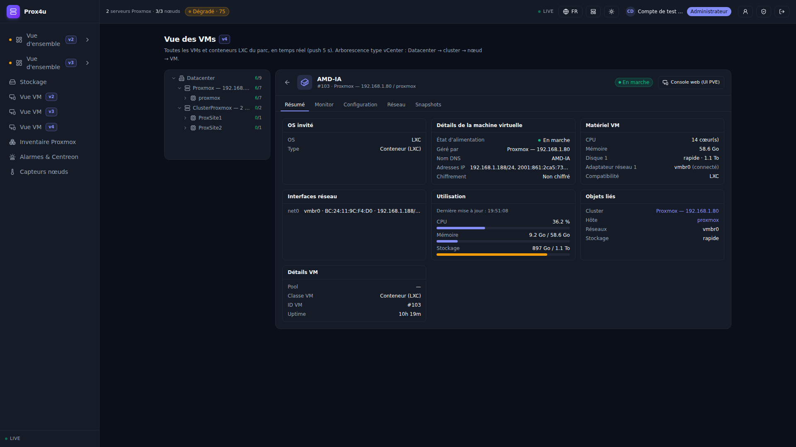

Panneau détail d'une VM/LXC : résumé (OS invité, matériel, réseau, utilisation), monitor, configuration, snapshots et console web PVE.

### Inventaire Proxmox

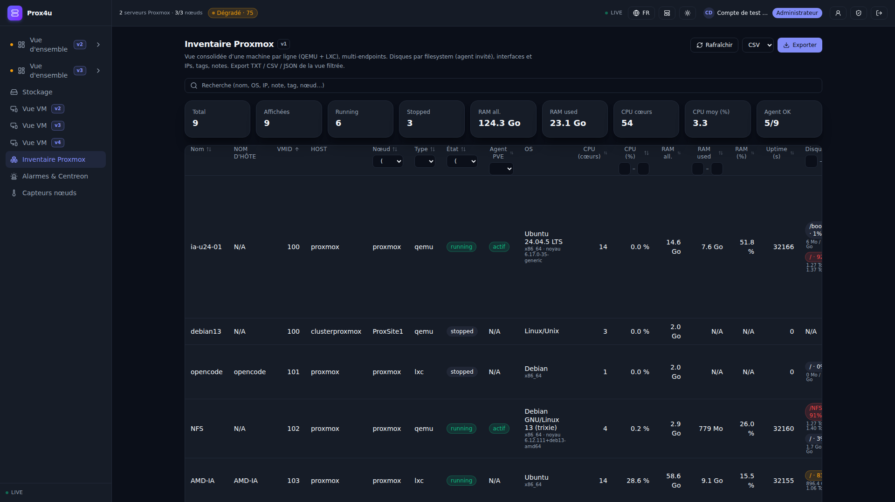

Vue consolidée d'une machine par ligne (QEMU + LXC) : OS réel (agent invité), disques par filesystem, interfaces et IPs, export TXT/CSV/JSON.

### Topologie réseau

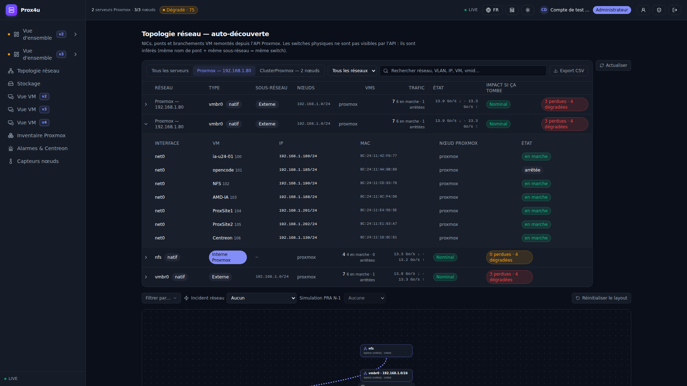

Topologie réseau auto-découverte (switches → nœuds → ponts → segments → VMs) avec inventaire, recherche unifiée et analyse d'impact incident.

### Stockage

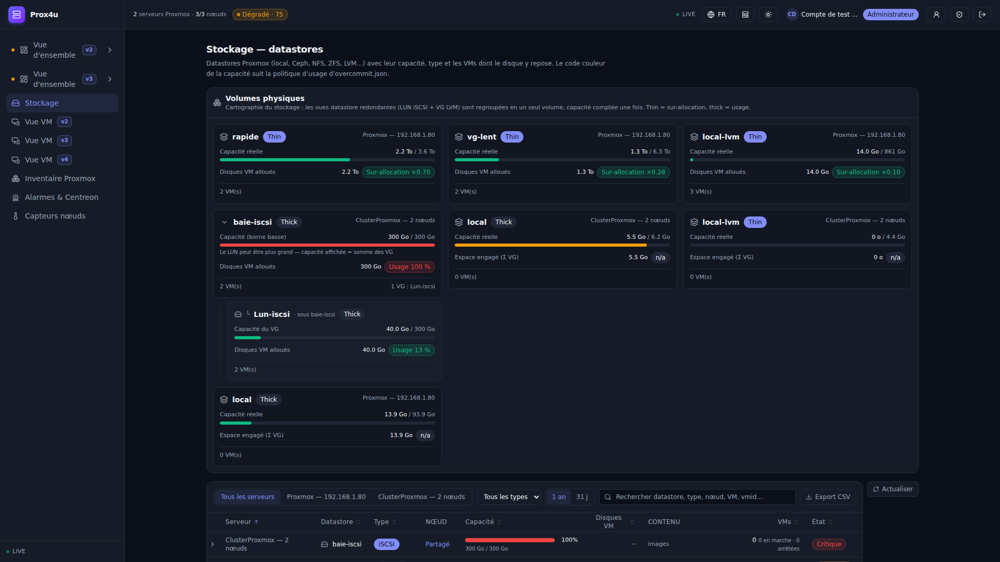

Inventaire des datastores (local, Ceph, NFS, iSCSI, ZFS) : capacité réelle, type, surallocation et VMs hébergées, multi-endpoints.

### Alarmes & Centreon

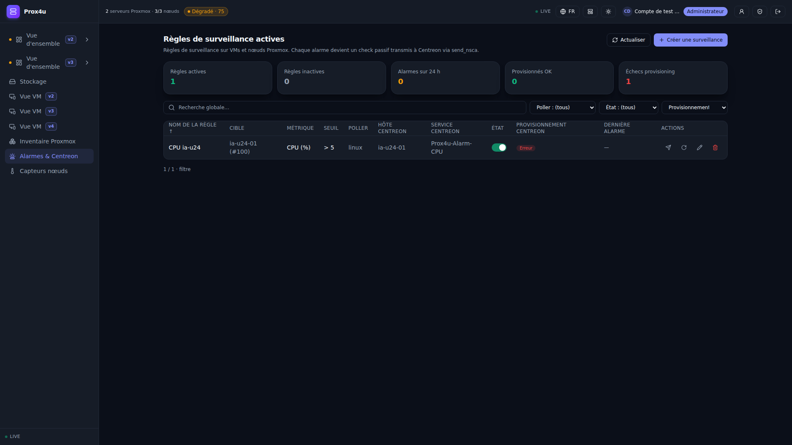

Règles de surveillance VMs/nœuds (CPU, RAM, disque, statut, IP, uptime) → alarmes transmises à Centreon en checks passifs `send_nsca`, provisioning automatique.

### Capteurs nœuds

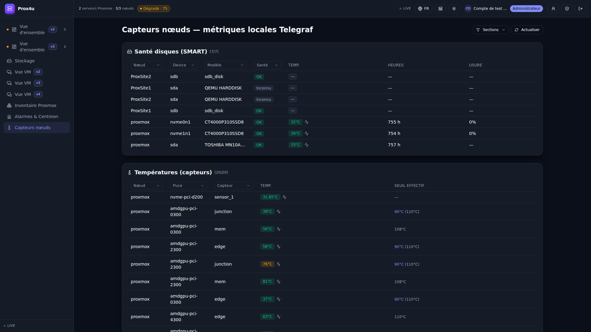

Métriques locales Telegraf par nœud : santé SMART des disques, températures capteurs, ZFS ARC et unités systemd, avec seuils personnalisables.

### Administration

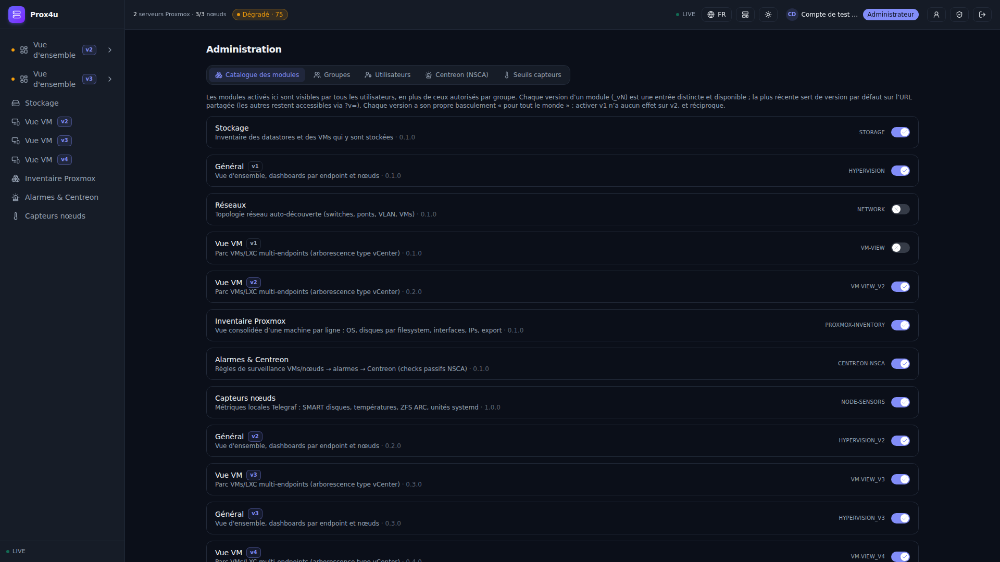

Administration : catalogue des modules (activation par version), groupes, utilisateurs, Centreon (NSCA) et seuils capteurs.

## Architecture

```
Proxmox VE 9 (API) × N endpoints ──► Poller (5 s, parallèle par endpoint) ──► Snapshot multi ──► WebSocket ──► UI
                                                         │
                                                         ├─► InfluxDB 3 Core : base raw (rétention 31 j, échantillons 5 s, tag cluster)
                                                         │        │
                                                         │        └─► Consolidateur (5 min, par cluster) ─► base consolidated (∞, buckets 5 min)
                                                         │
                                                         └─► Repli historique : RRD Proxmox (si InfluxDB absent/indisponible)

API HTTP : /api/dashboard · /api/endpoints · /api/metrics?timeframe=hour|day|week|month&endpoint=<id> · /api/capacity · /api/trends · /api/health · /api/node-sensors
```

Monorepo pnpm : `packages/shared` (types + calculs + i18n), `packages/server` (Fastify, poller, client PVE, InfluxDB), `packages/web` (React + ECharts).

## Module « Alarmes & Centreon »

Le module définit des **règles de surveillance** sur les VMs et nœuds Proxmox. Quand une condition (seuil + durée de confirmation) est remplie, l'alarme est envoyée à **Centreon** comme **check passif** via `send_nsca`. Le service passif correspondant est **créé et déployé automatiquement** avant le 1ᵉʳ envoi.

```
Prox4u (backend)
   │  1. Provisioning du service passif → CLAPI (SSH) ou API REST v1
   │     centreon -u <u> -p "$(cat)" -o SERVICE -a add -v "<host>;<service>"
   │     centreon -o SERVICE -a setparam -v "<host>;<service>;passive_checks_enabled;1"
   │     centreon -o SERVICE -a setparam -v "<host>;<service>;active_checks_enabled;0"
   │     (+ is_volatile=1, max_check_attempts=1, check_command=check_dummy!0)
   │     centreon -o POLLERGENERATE -v "<poller>"   puis   centreon -o CFGMOVE -v "<poller>"
   │  2. Engine (tick 15 s) : évalue les règles → machine à états ok⇄firing
   ▼
send_nsca (runtime)
   │  printf '<host>\t<service>\t<code>\t<output>\n' | send_nsca -H <nsca_host> -c <send_nsca.cfg>
   ▼
Centreon Engine (réception NSCA → statut du service passif)
```

- **Transport runtime imposé** : `send_nsca` (le fichier `send_nsca.cfg` est **généré automatiquement** par l'app à partir de la config, chmod 600).
- **Return code** : 0=OK (récupération), 1=WARNING, 2=CRITICAL, 3=UNKNOWN.
- **Provisionnement** : CLAPI (mode **SSH** — Prox4u n'est pas sur le central — ou local) **ou** API REST v1. Le choix se fait dans l'admin (onglet « Centreon (NSCA) »). Les mots de passe/token ne sont jamais loggués ni renvoyés en clair par l'API.

### Prérequis Centreon / NSCA (pas-à-pas)

1. **Daemon NSCA sur le central Centreon** : `nsca.cfg` avec `server_address` (0.0.0.0), `server_port` (5668), `allow_2des = true`, et un `password` (même mot de passe que dans Prox4u). Redémarrer le service `centengine`/`nsca`.
2. **Client `send_nsca` sur le serveur Prox4u** : `apt-get install nsca-client` (ou équivalent) — le binaire `send_nsca` doit être dans le `PATH`.
3. **Utilisateur CLAPI** (si transport CLAPI) : un compte Centreon avec droits de configuration (`SERVICE`, `POLLERGENERATE`, `CFGMOVE`) + une **clé SSH** de Prox4u vers le central (mode `ssh`).
4. **Token d'API** (si transport REST v1) : un utilisateur API Centreon + son token (Basic auth sur `/api/restapi`).
5. **Poller** : le poller cible doit exister dans Centreon (Linux, Windows, Infra…). Le service passif est rattaché à l'hôte déjà présent dans Centreon.

### Procédure dans Prox4u

1. **Administration → Centreon (NSCA)** : activer le module, choisir le transport (CLAPI/REST), renseigner le central + identifiants, les pollers (**nom + IP** — l'IP est la destination NSCA des trames de ce poller, repli sur le serveur NSCA du central si vide), le serveur NSCA (hôte/port/mot de passe), et le mapping VM→hôte Centreon (bouton **Ajouter** pour d'autres correspondances).
2. **Alarmes & Checks NSCA → Créer une surveillance** : définir la règle (cible VM/nœud, métrique, opérateur, seuil, durée de confirmation, sévérité, poller, hôte+service Centreon, message). À la soumission, le service est provisionné + la config déployée, puis la règle est enregistrée (statut provisioning affiché).
3. **Tableau des règles** : activer/désactiver, **Tester** (trame NSCA immédiate), **Reprovisionner** (relance la création si échec), supprimer.

### Exemples livrés

- **Trame générée** : `vm-web-01\tProx4u-Alarm-CPU\t2\tvm-web-01 CPU 94% (seuil 90%)\n`
- **Commande CLAPI de création** : `centreon -u clapi -p "$(cat)" -o SERVICE -a add -v "vm-web-01;Prox4u-Alarm-CPU"` (suivi des `setparam` + `POLLERGENERATE`/`CFGMOVE`).
- **Script de test manuel** : [`scripts/nsca-test.sh`](./scripts/nsca-test.sh) — envoie une trame vers un NSCA de test et vérifie le statut dans Centreon.

> **Zabbix ensuite** : la famille `centreon-nsca` et le namespace `/api/alarms/*` sont conçus pour accueillir un 2ᵉ backend (Zabbix) sans toucher au cœur — le transport runtime et le provisioning seraient spécialisés par backend.

## Prérequis

- Node.js ≥ 20, pnpm ≥ 9
- Proxmox VE 9 avec un **API token** en lecture seule — à créer **par commandes, sans GUI** : `deploiement/10-proxmox-token.sh` sur chaque serveur Proxmox (rôle `ManagerReader` + user dédié + token + auto-test)
- Docker (optionnel) pour InfluxDB 3 Core

> **Déploiement sur un autre serveur** : procédure complète dans [deploiement/DEPLOY.md](./deploiement/DEPLOY.md) — tarball via `deploiement/20-package-release.sh` (sans git), tokens par commandes, systemd au boot.

## Démarrage rapide

```bash
git clone <repo> && cd Prox4u
cp .env.example .env          # puis éditer INFLUX_URL / tokens (ou clusters.json pour le multi-endpoints)
pnpm install
pnpm build

# InfluxDB (optionnel mais recommandé) — scripts numérotés dans l'ordre d'exécution
./deploiement/40-tls-init.sh      # génère les certificats auto-signés (data/tls/)
./deploiement/50-influxdb-init.sh # génère le token admin + met à jour .env
sudo chown -R 1500:1500 data/influxdb   # user non-root du conteneur (voir note ci-dessous)

./up.sh                       # démarrage complet : InfluxDB (Docker) + application
# ou séparément :
# docker compose up -d influxdb
# ./server.sh start           # ou : pnpm dev (mode développement)
```

L'application est sur <https://localhost:8080> (certificat auto-signé : le navigateur demandera confirmation). Sans `INFLUX_TOKEN` (ou sans Docker), tout fonctionne en repli RRD Proxmox.

**Explorer** (UI officielle InfluxDB 3 : requêtes SQL + visualisations) est sur <https://localhost:8888> — connexion à InfluxDB préconfigurée (`data/explorer/config/config.json`). Optionnel : `docker compose up -d explorer` / `docker compose stop explorer`.

> **Note permissions (Docker)** — le conteneur tourne en non-root (`user: 1500:1500`, configurable via `INFLUX_UID`/`INFLUX_GID` dans `.env`) : le dossier `data/influxdb/` doit lui appartenir (`chown -R`). La doc officielle InfluxDB ne couvre pas ce point. Les clés TLS sont en 644 pour être lisibles par ce user (certificats auto-signés, déploiement local).

## Configuration

Variables dans `.env` (voir `.env.example`) :

| Variable | Défaut | Description |
|---|---|---|
| `PVE_URL` | `https://127.0.0.1:8006` | URL de l'API Proxmox |
| `PVE_USER` / `PVE_TOKEN_ID` / `PVE_TOKEN_VALUE` | — | Identifiants du token API (`user@realm!tokenid=value`) |
| `TLS_REJECT_UNAUTHORIZED` | `false` | `true` = refuser les certificats auto-signés |
| `MOCK` | `0` | `1` = données simulées (démo) |
| `MOCK_SCENARIO` | `nominal` | `nominal` \| `degraded` \| `critical` |
| `PORT` | `8080` | Port du serveur (HTTP ou HTTPS selon TLS) |
| `TLS_KEY` / `TLS_CERT` | *(vides)* | Paires de certificats de l'application — **vides = HTTP clair** |
| `INFLUX_URL` | `http://localhost:8181` | URL InfluxDB 3 Core (`https://…` en TLS) |
| `INFLUX_TOKEN` | *(vide)* | Token admin (`apiv3_…`) — **vide = InfluxDB désactivé** |
| `INFLUX_RAW_DB` | `raw` | Base brute (rétention 31 j) |
| `INFLUX_AGG_DB` | `consolidated` | Base consolidée (rétention infinie) |
| `INFLUX_CA_CERT` | *(vide)* | Certificat auto-signé InfluxDB à faire confiance (fetch app → InfluxDB) |
| `INFLUX_LAN_BIND` | `127.0.0.1` | IP interne d'exposition de l'API InfluxDB (8181) pour les agents Telegraf des nœuds — *vide = localhost-only* |

## Multi-cluster

Un fichier `clusters.json` à la racine déclare les endpoints Proxmox (un par cluster, ou un par nœud autonome). Copier `clusters.example.json`, remplir, puis `chmod 600 clusters.json` :

```json
{
  "endpoints": [
    { "id": "proxmox", "name": "Cluster principal", "url": "https://192.168.1.80:8006",
      "token": "user@pve!tokenid=xxxxxxxx" }
  ]
}
```

- **`clusters.json` est gitignored** (contient des tokens) ; le template `clusters.example.json` est commité.
- Sans ce fichier, l'app repasse en **mono-endpoint** `default` construit depuis `PVE_URL`/`PVE_USER`/`PVE_TOKEN_*` du `.env`.
- Chaque site de `sites.json` se rattache à un endpoint via son champ `"endpoint"` (id) ; template d'exemple : `sites.example.json` (mapping nœuds → bâtiments, requis pour le PRA — guide de remplissage champ par champ dans `deploiement/DEPLOY.md` §6).
- L'historique InfluxDB est taggé par `cluster` ; les lignes écrites avant le multi-cluster (sans tag) sont attribuées à l'endpoint par défaut — aucun backfill nécessaire.

## InfluxDB 3 Core

- **Deux bases** : `raw` (rétention native **31 jours**, échantillons toutes les 5 s) et `consolidated` (rétention **infinie**, agrégats 5 min). Les rétentions sont fixées à la création (immuable en Core) et recréées automatiquement au démarrage.
- **Consolidateur** : job interne toutes les 5 min (fenêtres complètes uniquement), avec reprise après arrêt via `data/influxdb/consolidation-state.json`.
- **Repli** : toute erreur ou réponse vide InfluxDB bascule automatiquement sur les RRD Proxmox ; le champ `source` (`influx` | `rrd`) est renvoyé par l'API et affiché dans l'UI.

### Schéma des mesures

| Base | Mesure | Tags | Champs / Fields |
|---|---|---|---|
| `raw` + `consolidated` | `storage_metrics` | `cluster` | `used_bytes`, `total_bytes` — stockage VM au niveau endpoint, série de référence des graphiques « Disque » (pondérée Σused/Σtotal à la lecture) |
| `raw` + `consolidated` | `node_metrics` | `cluster`, `node` | `cpu_pct`, `ram_pct`, `disk_pct` (rootfs), `net_in_bps`, `net_out_bps` |
| `raw` + `consolidated` | `vm_metrics` | `cluster`, `node`, `vmid`, `name` | `cpu_pct`, `mem_bytes` (VMs running uniquement) |

Lecture : `hour`/`day`/`week` sur `raw` (buckets 1 min / 5 min / 1 h), `month` + capacity + trends sur `consolidated`.

## TLS

HTTPS pour l'application **et** InfluxDB, avec certificats auto-signés générés localement (aucun CA externe).

```bash
./deploiement/40-tls-init.sh   # génère data/tls/{app,influxdb}-{key,cert}.pem (10 ans)
```

- **Application** : `TLS_KEY` + `TLS_CERT` dans `.env` → le serveur écoute en HTTPS sur `PORT`, WebSocket en `wss`. Sans ces variables, HTTP clair.
- **InfluxDB** : le conteneur démarre avec `--tls-cert/--tls-key` (montés en lecture seule depuis `data/tls/`) ; `INFLUX_URL=https://…` et `INFLUX_CA_CERT` permettent à l'app de faire confiance au certificat auto-signé.

Options du script : `TLS_DAYS` (validité, défaut 3650) et `TLS_SAN_EXTRA` (SAN supplémentaires, ex. `DNS:proxmox.local,IP:192.168.1.50`) pour accéder via un hostname/IP autre que `localhost`.

## API

| Endpoint | Description |
|---|---|
| `GET /api/health` | Statut du serveur |
| `GET /api/dashboard` | Snapshot multi-endpoints (KPIs agrégés, santé + PRA par endpoint + PRA global cross-endpoints + alarmes) |
| `GET /api/endpoints` | Liste compacte des endpoints (id, nom, état, score) — alimente la sidebar |
| `GET /api/metrics?timeframe=hour\|day\|week\|month&endpoint=<id>` | Points métriques d'un endpoint + `source` |
| `GET /api/capacity?endpoint=<id>` | Prévisions de saturation 30 j + `source` |
| `GET /api/trends?endpoint=<id>` | Tendance 7 j + répartition OS + `source` |
| `GET /api/overcommit-risk?endpoint=<id>` | Risque de surallocation dynamique (pire cas p95 7 j par VM) |
| `GET /api/network-topology` | Topologie réseau auto-découverte par endpoint (switches → nœuds → ponts → segments → VMs) |
| `GET /api/storage-inventory` | Inventaire stockage → VMs par endpoint (datastores + VMs avec leur datastore) |
| `GET /api/node-sensors` | Métriques locales Telegraf par nœud (SMART, températures, ZFS ARC, unités systemd) — base `raw`, cache 1 min |
| `WS /ws` | Push du snapshot multi-endpoints (5 s) |

## Lancement & développement

### Mode standard — API + frontend sur un seul port (recommandé)

```bash
pnpm build                 # build du frontend → packages/web/dist
./server.sh start          # ou : stop | restart | status — logs dans logs/
```

Le serveur sert **l'API et le frontend pré-buildé** sur `https://localhost:8080` (HTTPS si `TLS_KEY`/`TLS_CERT` sont définis dans `.env`, sinon HTTP clair). Après tout changement de code côté web, refaire `pnpm build` pour que le 8080 reflète les modifications.

### Mode développement — Vite + HMR sur le port 5173

```bash
./server.sh start          # backend seul (ou `pnpm dev` : serveur tsx watch + vite en parallèle)
cd packages/web
VITE_API_PROXY=https://localhost:8080 VITE_WS_PROXY=wss://localhost:8080 pnpm dev --host 0.0.0.0
```

Le proxy Vite vise par défaut `https://localhost:8080` ; `VITE_API_PROXY`/`VITE_WS_PROXY` permettent de pointer un autre backend (ex. mock).

### Démarrage automatique

| Contexte | Mécanisme |
|---|---|
| **Production** | service systemd `deploiement/prox4u.service` (`Restart=always`, boot + crash) — procédure : [deploiement/DEPLOY.md](./deploiement/DEPLOY.md) §8 |
| **Machine de dev** | cron watchdog, `start` étant idempotent (« déjà en cours » → exit 0) : `@reboot …/server.sh start` + `* * * * * …/server.sh start` |

### Commandes utilitaires

```bash
pnpm test         # vitest (shared + server)
pnpm typecheck    # tsc --noEmit sur les 3 packages
pnpm build        # build production (shared → server → web)
./up.sh           # démarrage complet : InfluxDB (Docker) + application
```

## Structure

```
├── deploiement/              # LIVRABLE de déploiement — autonome : on déplace le dossier entier sur la cible et on déploie depuis lui ; porte d'entrée : DEPLOY.md
│   ├── DEPLOY.md             # procédure de déploiement sur un nouveau serveur (FR) + DEPLOY.en.md (EN)
│   ├── 10-proxmox-token.sh   # SUR CHAQUE PVE : compte + token API Proxmox lecture seule (idempotent, --dry-run)
│   ├── 20-package-release.sh # MACHINE DE DEV : build + tarball de l'application → releases/ (sans secrets)
│   ├── releases/             # tarball de l'application (produit par 20, gitignored) — le kit contient l'app
│   ├── 30-env-setup.sh       # SERVEUR APP : .env auto-rempli (INFLUX_UID/GID, EXPLORER_SESSION_KEY) — arg : [dossier-install]
│   ├── 40-tls-init.sh        # SERVEUR APP : certificats auto-signés app + InfluxDB (SAN) — arg : [dossier-install]
│   ├── 50-influxdb-init.sh   # SERVEUR APP : token admin InfluxDB + sync .env (idempotent) — arg : [dossier-install]
│   └── prox4u.service  # unit systemd du serveur applicatif (boot + restart auto)
├── docker-compose.yml        # InfluxDB 3 Core (8181) + Explorer UI (8888), secret token
├── clusters.json             # endpoints Proxmox multi-cluster (600, gitignored) — template : clusters.example.json
├── sites.json                # topologie des sites/bâtiments (PRA), rattachement par endpoint — template : sites.example.json
├── overcommit.json           # politique de surallocation + seuils d'usage (hot-reload, source unique du code couleur)
├── skills/                   # base de connaissance (13 SKILL.md + README.md) — reprise humain ou IA
├── STATUS.md                 # état d'avancement : jalons livrés, pièges corrigés, points en attente
├── up.sh                     # démarrage complet : InfluxDB (Docker) + application
├── server.sh                 # start/stop/restart/status de l'app seule
└── packages/
    ├── shared/               # types, calculs (PRA, health, prévisions), i18n FR/EN
    ├── server/               # Fastify : poller multi-endpoints, client PVE, InfluxDB, routes API
    └── web/                  # React + ECharts : host applicatif + plugins métier (voir « Architecture plugin »)
```

## Architecture plugin

Le frontend (`packages/web`) est un **host** qui charge des **plugins** métier. Les trois modules d'origine (hypervision, network, storage) sont des plugins ; le host fournit le layout, le router, le store temps réel et les services partagés.

```
packages/web/src/
├── core/                     # HOST — ne contient aucun code métier de module
│   ├── plugin/               # contrat + runtime : types (zod), registry, loader, eventBus, logger
│   ├── config/features.ts    # feature flags VITE_USE_PLUGIN_*
│   ├── api/                  # client REST partagé (/api/*)
│   ├── data/                 # store WS (zustand) + hooks
│   └── ui/                   # PluginSlot, PluginMenu, ModuleDisabled
├── plugins/                  # PLUGINS — un dossier par module métier
│   ├── hypervision/          # routes /, /e/:endpointId, /e/:endpointId/n/:nodeId (menu order 10)
│   ├── network/              # route /topology (menu order 20)
│   ├── storage/              # route /storage (menu order 30)
│   ├── vm-view/              # route /vms (menu order 40)
│   ├── proxmox-inventory/    # route /proxmox-inventory (menu order 50)
│   ├── centreon-nsca/        # routes /alarms, /alarms/new, /alarms/edit/:id (menu order 60)
│   └── node-sensors/         # route /node-sensors (menu order 70) — métriques locales Telegraf
├── components/               # layout (sidebar, topbar) + primitives UI partagées
├── store/ · hooks/ · lib/    # état host (layout, thème), hook ECharts, utilitaires
└── app.tsx · main.tsx        # bootstrap : loadPlugins() avant le premier rendu
```

### Contrat

Un plugin est un objet `Plugin` exporté par `plugins/<id>/index.ts` :

```ts
export const storagePlugin: Plugin = {
  manifest: {
    id: 'storage',            // stable, /^[a-z][a-z0-9-]*$/
    name: 'Storage',
    version: '0.1.0',         // semver
    routes: [{ path: '/storage', element: StoragePage }],
    menu: [{ id: 'storage-inventory', to: '/storage', labelKey: 'nav.storage', icon: HardDrive, order: 30 }],
    dependencies: [],         // ids de plugins requis (optionnel)
  },
  init(ctx) { /* ctx.api, ctx.eventBus, ctx.logger */ },
  dispose() { /* cleanup optionnel */ },
};
```

- **Manifest** : validé au chargement par un schéma **zod** (`pluginManifestSchema`) — un manifest invalide fait échouer le plugin proprement (try/catch par plugin dans le loader), jamais l'app.
- **Routes** : injectées dans le `<Routes>` du host ; **menu** : rendu par `PluginMenu` (tri par `order`).
- **Contexte** (`init(ctx)`) : `api` (client REST partagé — le frontend ne parle jamais directement à Proxmox/InfluxDB), `eventBus`, `logger`. Les données temps réel transitent par le store WS du host (`core/data`).
- **Loader** : tableau statique d'imports explicites (`core/plugin/plugins.ts`) — pas de chargement dynamique asynchrone, chaque plugin est isolé par try/catch.

### Feature flags

Chaque plugin a un flag `VITE_USE_PLUGIN_<ID>` (défaut **ON**). Les flags sont des **disjoncteurs** : `=false` désactive proprement le module (écran de repli `ModuleDisabled`, pas de route morte) — utile en production si un plugin pose problème.

```bash
VITE_USE_PLUGIN_STORAGE=false pnpm dev   # désactive le module stockage
```

### Ajouter un plugin

1. Créer `plugins/<id>/` avec `index.ts` (manifest + `init`) et les pages/composants du module.
2. L'ajouter au tableau `core/plugin/plugins.ts` (import explicite + gating par flag).
3. Déclarer le flag dans `core/config/features.ts`.
4. Les routes et l'entrée de menu sont automatiques (manifest).

## Licence

Projet de **CIETED EURL** ([www.cieted.fr](https://www.cieted.fr) · [www.prox4u.fr](http://www.prox4u.fr/)) publié sous licence **Apache License 2.0** — voir [`LICENSE`](./LICENSE).
